# Arquitetura inicial — decisão de 2026-11-03

> Atualização do passo 2: toolchain C++20 portátil e candidato fixado para avaliação Windows; provas restritas passaram até a entrada principal após InitHeap. O boot completo continua pendente. Consulte [as evidências e decisões atualizadas](NATIVE_BRINGUP.md). As decisões iniciais abaixo registram o ponto de partida.

Estado: arquitetura aceita para iniciar a prova de boot. Os módulos futuros descritos aqui ainda não foram implementados. O código existente continua em `src/Disc.cs` e `src/Program.cs`; não vamos criar projetos vazios nem mover arquivos antes de existir necessidade concreta.

## Produto e limites

Distribuir launcher, ferramentas e runtime. O usuário fornece a imagem extraída do jogo; preparação e geração de código acontecem localmente. A distribuição do projeto não inclui imagem, boot extraído, assets nem código gerado a partir do jogo.

Alvo: Windows 10/11 x64, renderer Vulkan 1.3, saída até 3840×2160, apresentação até 160 Hz, configurações antes de iniciar e overlay F1 durante o jogo. Atingir 160 FPS reais com a velocidade correta depende de pesquisa específica e hardware medido; não é um requisito já demonstrado. Estados, atalhos, fast-forward, contadores e backup fazem parte do produto planejado.

## Componentes e responsabilidades

| Componente | Decisão | Responsabilidade e fronteira |
| --- | --- | --- |
| Launcher | C# / WinForms, .NET Framework 4.8 nesta fase | Seleção de disco, perfis, preparação, tarefas de build, configuração inicial e início do processo de jogo. Não executa código MIPS. |
| Ferramentas de análise | Leitor C# atual; adaptador futuro para análise MIPS | Produzir inventário e evidências; separar funções, dados e overlays antes de gerar código. |
| Adaptador de recompilação | Contrato independente do fornecedor | Consumir perfil validado e binários locais; invocar ferramentas com argumentos estruturados; produzir fontes e relatório de cobertura. |
| Runtime | C++20, processo Windows x64 separado | Executar código traduzido e implementar os serviços necessários do PS1; possuir o estado completo da máquina. |
| Renderer | Backend Vulkan 1.3 separado da lógica de GPU PS1 | Receber comandos/VRAM, produzir imagem e apresentar. O contrato deve permitir testes sem apresentação e captura de imagem para comparação. |
| Overlay | Interface dentro do runtime; biblioteca ainda não escolhida | Editar a mesma configuração do launcher, controlar pausa/velocidade/estados e consumir entrada antes do jogo. |
| Persistência | Serviço do runtime e gerenciador de backup do launcher | Memory cards, estados, restauração e histórico; escrita coordenada por perfil de jogador. |

Launcher e runtime se comunicam inicialmente por arquivos JSON versionados e linha de comando. O launcher acompanha código de saída e logs. Não haverá DLL do runtime carregada dentro do launcher. Comunicação em tempo real só será acrescentada se um recurso concreto exigir.

## Fluxo de preparação e execução

```mermaid
flowchart LR
    A[CUE/BIN/ISO local] --> B[Preparar e calcular hashes]
    B --> C[Manifesto + boot local]
    C --> D[Identificar perfil de pesquisa]
    D --> E[Analisar funções e overlays]
    E --> F[Perfil de geração validado]
    F --> G[Recompilar MIPS para C++]
    G --> H[Compilar e vincular runtime]
    H --> I[Configurar e iniciar jogo]
    I --> J[Overlay F1 e persistência]
```



Somente A–D têm ferramentas disponíveis atualmente. O perfil de identidade não contém limites de funções nem substitui o perfil de geração. Imagem desconhecida pode ser analisada, mas não recebe automaticamente patches de outra cópia. Executáveis gerados são cache local; arquivos originais não são modificados.

Estados futuros do pipeline: `selected → prepared → identified → analyzed → generated → built → boot-verified`. Falhas têm etapa, comando, código de saída e log próprios; uma etapa não marca a seguinte como concluída. Trabalho interrompido permanece em diretório temporário e só é promovido ao cache após sucesso. Cancelamento encerra a árvore de processos da tarefa e preserva a última saída válida.

## Contratos de dados

| Artefato | Campos e regras principais |
| --- | --- |
| Manifesto de preparação v1 (existente) | Caminho local, SHA-256 da imagem e do executável, layout detectado, boot, endereços e inventário. Não contém prova de execução. |
| Perfil de identidade v1 (adicionado nesta etapa) | Identificador estável, hashes exatos, tamanho, metadados observados e evidências de validação. Sem caminhos pessoais. `research-only` não autoriza anunciar suporte. |
| Perfil de geração (futuro) | Hash do binário, mapa de funções/dados, overlays, saltos indiretos, chamadas BIOS e patches documentados com precondições. Bloquear geração quando faltarem informações exigidas pelo backend. |
| Descritor de build (futuro) | Hashes de entrada, perfil, patches, gerador, dependências, compilador, SDK, opções, fontes geradas e executável de saída. |
| Configuração compartilhada (futura) | `schemaVersion`, vídeo, áudio, entrada, atalhos, velocidade e persistência. Validar tipos e faixas; migração explícita; valores desconhecidos não acionam recursos arbitrários. |
| Relatório de sessão (futuro) | Build e perfil usados, início/fim, tempo ativo real, tempo simulado, falhas e métricas de quadros. Sem conteúdo de memória por padrão. |

Configurações alteradas pelo overlay são gravadas pelo runtime; o launcher não escreve no mesmo perfil enquanto a sessão estiver ativa. Manter uma única sessão gravadora por perfil de jogador; outra instância deve recusar o uso concorrente ou pedir outro perfil.

## Relógios e desempenho

O runtime terá relógios distintos para máquina simulada, apresentação e tempo real monotônico. A frequência exata da revisão deve ser medida durante a análise; o serial não define sozinho uma taxa segura de simulação.

- A simulação original estabelece a referência de correção.
- Fast-forward altera deliberadamente a velocidade simulada. Oferecer velocidades limitadas, tecla mantida ou alternância; não acumular tempo pausado como tempo ativo. Estratégia de áudio acelerado depende de validação.
- Alta frequência de apresentação não muda automaticamente a simulação. Interpolação, se adotada, deve ser identificada e não contada como novos passos do jogo.
- O contador exibe tempo ativo real da sessão e acumulado do perfil; tempo simulado é uma métrica separada. Carregar um estado não reduz o tempo real acumulado.
- Resolução de saída e resolução interna são opções distintas. Preservar proporção original como padrão; widescreen depende de correções próprias.

O diagnóstico deve separar FPS de renderização, apresentação e taxa de simulação, além do tempo de CPU/GPU. Medir cenas definidas antes de prometer 4K/160 FPS.

## Saves, estados e backups

Memory cards são o progresso primário. Save states são checkpoints da máquina completa: registradores, RAM, dispositivos, filas/eventos, posição temporal e estado de leitura do disco, além dos dados necessários para reconstruir a apresentação. Não serializar ponteiros ou identificadores de objetos Vulkan.

Cabeçalho futuro de estado: versão do formato, hashes da imagem e dos patches, identificador de compatibilidade do runtime, formato dos dispositivos, tamanho e checksum do payload. Inicialmente, exigir mesma versão compatível do runtime e mesmo conteúdo de jogo; recusar estados incompatíveis antes de alterar a sessão. Carregar em estado temporário, validar e só então substituir o estado ativo em um ponto seguro.

Slots manuais e rápidos são independentes. A interface informa a política de restauração dos memory cards: um estado não deve sobrescrever silenciosamente progresso mais recente do disco. Antes de qualquer rollback persistente, criar backup; a política precisa ser implementada e testada antes de liberar load states.

Gravações persistentes usam temporário no mesmo volume, validação e substituição segura, mantendo a versão anterior recuperável. Backups incluem identificação do perfil, data UTC, tamanho e checksum. Retenção limitada por quantidade/espaço; nunca remover a única cópia válida. Criar backup antes de restauração e migração. Backup durante jogo exige snapshot consistente coordenado pelo runtime, não cópia arbitrária de um arquivo em uso.

## Organização de dados planejada

```text
profiles/                         metadados públicos e perfis revisados
docs/                             decisões, contratos e evidências sem conteúdo do jogo
src/                              launcher e leitor atuais
scripts/                          build, testes e verificação
roms/                             imagens locais ignoradas pelo Git
local/prepared/<image-hash>/       manifesto e executável MIPS extraído
local/analysis/<image-hash>/       mapas e relatórios privados de engenharia
local/generated/<build-key>/       fontes C++ derivadas, privadas
local/runtime/<build-key>/         executável nativo e descritor
build/                            ferramentas compiladas, ignoradas
```

Para o produto instalado, saves, configurações, estados e backups ficam fora da pasta de instalação, sob `%LOCALAPPDATA%\DW3Recompiled\players\<player-id>\`. Separar identidade de conteúdo da família de saves: tradução e original só compartilham progresso após teste explícito. Essas pastas de usuário ainda não são criadas pelo programa atual.

## Decisões de dependências

Preservar o launcher atual enquanto ele atender à preparação. Não introduzir framework web, SDK .NET novo ou serviço em nuvem nesta etapa. Para o runtime, adotar C++20 e CMake como direção; compilador e SDK exatos serão registrados após uma prova de build na máquina.

PS1Recomp é candidato para avaliação, não dependência selecionada. A documentação e o CMake upstream descrevem uma cadeia de análise/geração e C++20; o runtime documentado usa OpenGL. Ainda faltam revisão de fonte, teste Windows, avaliação de overlays e execução deste jogo. Uma prova diagnóstica com outro renderer deve ser identificada como tal; a versão de produto continua tendo Vulkan 1.3 como alvo. Não baixar ou incorporar upstream sem fixar um commit e registrar licença/dependências.

Vulkan deve ser validado no loader e no dispositivo físico, incluindo recursos realmente usados; a existência do SDK ou de `vulkan-1.dll` não prova compatibilidade. Recursos de hardware exigidos serão fechados com o renderer. Nenhuma compatibilidade de GPU local foi comprovada nesta etapa.

## Critérios de passagem para a prova de boot

1. Perfil de pesquisa confere com hashes reais da imagem e do boot.
2. Build e testes das ferramentas atuais passam a partir do código versionado.
3. Ferramentas nativas são inventariadas e um compilador C++ é validado antes de integrar o backend.
4. Backend escolhido tem commit fixo, revisão de licença e teste mínimo sem ROM.
5. Análise local produz mapa inicial de código/dados, pontos de entrada e lista de lacunas de overlays/BIOS/saltos indiretos.
6. Só depois gerar e executar o primeiro binário com logs comparáveis; não anunciar jogo jogável com base apenas em compilação bem-sucedida.

Os itens 1 e 2 são verificáveis nesta etapa. Os itens 3–6 pertencem à próxima execução de engenharia.

## Referências consultadas em 2026-11-03

- [PS1Recomp README](https://github.com/PS1Recomp/ps1-recomp/blob/main/README.md) e [CMake raiz](https://github.com/PS1Recomp/ps1-recomp/blob/main/CMakeLists.txt): avaliação preliminar, sem adoção de código. Referências móveis; a integração deverá usar commit imutável.
- [Khronos — versões de Vulkan](https://docs.vulkan.org/guide/latest/versions.html): distinção entre versão da instância e do dispositivo.
- [PS-X EXE e SYSTEM.CNF](https://psx-spx.consoledev.net/cdromfileformats/): referência do formato de entrada.
